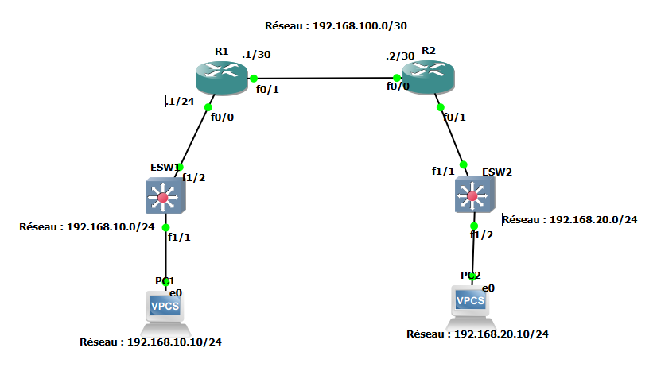
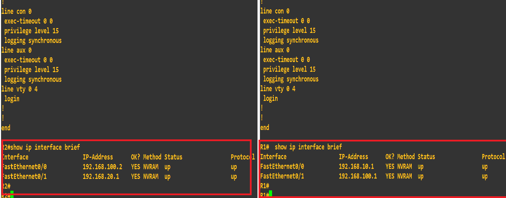
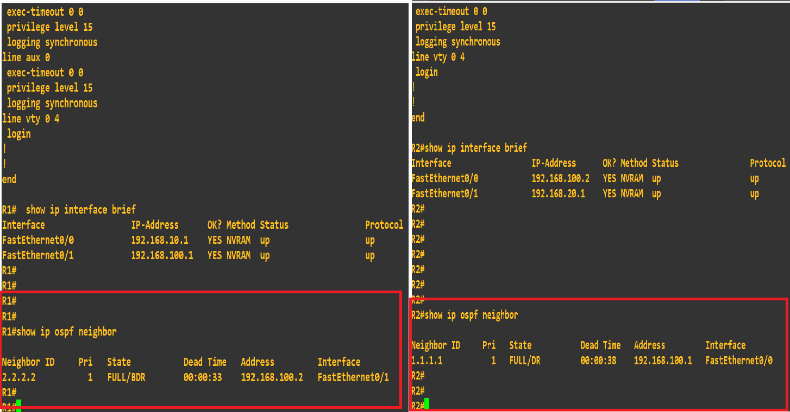
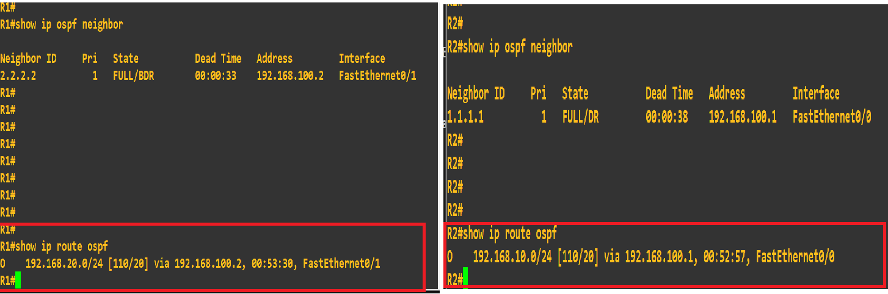
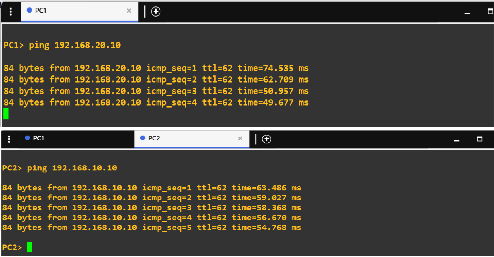

# LAB05 — Routage dynamique OSPF avec Cisco IOS et GNS3

## 1. Présentation du laboratoire

Ce laboratoire met en œuvre le routage dynamique **OSPF (Open Shortest Path First)** dans une topologie réseau composée de deux routeurs Cisco 2691, de commutateurs Ethernet et de deux postes clients virtuels VPCS.

L'objectif est de permettre aux routeurs d'échanger automatiquement leurs informations de routage afin d'assurer la communication entre deux réseaux locaux distincts, sans avoir à configurer manuellement des routes statiques vers les réseaux distants.

Ce travail s'inscrit dans une progression pratique orientée vers les réseaux d'entreprise, la préparation aux certifications Cisco CCNA et CCNP Enterprise, ainsi que la constitution d'un portfolio technique.

### Informations générales

- **Numéro du laboratoire :** LAB05
- **Thème :** Routage dynamique OSPF
- **Émulateur réseau :** GNS3
- **Hyperviseur :** VMware Workstation Pro
- **Routeurs :** Cisco 2691 — IOS 12.4(15)T14
- **Commutateurs :** Cisco 3725 avec module EtherSwitch NM-16ESW
- **Postes clients :** VPCS
- **Protocole de routage :** OSPFv2, aire 0
- **Statut :** Configuration et tests de connectivité validés

---

## 2. Objectifs pédagogiques

À l'issue de ce laboratoire, les compétences suivantes ont été mises en pratique :

- Configurer les interfaces IPv4 des routeurs Cisco.
- Comprendre le rôle d'un réseau de transit entre deux routeurs.
- Configurer OSPFv2 avec des identifiants de routeur distincts.
- Annoncer des réseaux dans l'aire OSPF 0.
- Établir et vérifier un voisinage OSPF.
- Interpréter les routes apprises dynamiquement dans la table de routage.
- Utiliser une interface OSPF passive sur les réseaux locaux.
- Vérifier la connectivité entre deux réseaux locaux distants.
- Diagnostiquer un problème de câblage ou de sélection d'interface dans GNS3.

---

## 3. Architecture et topologie

La topologie comprend deux LAN reliés par un réseau de transit entre R1 et R2.

- **LAN 1 :** réseau `192.168.10.0/24`
- **Réseau de transit :** réseau `192.168.100.0/30`
- **LAN 2 :** réseau `192.168.20.0/24`

### Schéma logique



*Figure 1 — Topologie GNS3 du laboratoire OSPF.*

### Chemin de communication

```text
PC1
 |
SW1
 |
R1 Fa0/0
R1 Fa0/1
 |
 | Réseau de transit : 192.168.100.0/30
 |
R2 Fa0/0
R2 Fa0/1
 |
SW2
 |
PC2
```

Les interfaces `FastEthernet0/1` de R1 et `FastEthernet0/0` de R2 assurent la liaison inter-routeurs. Les interfaces `FastEthernet0/0` de R1 et `FastEthernet0/1` de R2 desservent les LAN.

---

## 4. Plan d'adressage IPv4

| Équipement | Interface | Adresse IPv4 | Masque |
|---|---|---|---|
| PC1 | Ethernet | `192.168.10.10` | `255.255.255.0` |
| R1 | FastEthernet0/0 | `192.168.10.1` | `255.255.255.0` |
| R1 | FastEthernet0/1 | `192.168.100.1` | `255.255.255.252` |
| R2 | FastEthernet0/0 | `192.168.100.2` | `255.255.255.252` |
| R2 | FastEthernet0/1 | `192.168.20.1` | `255.255.255.0` |
| PC2 | Ethernet | `192.168.20.10` | `255.255.255.0` |

### Passerelles par défaut

- PC1 utilise `192.168.10.1`.
- PC2 utilise `192.168.20.1`.

Le réseau de transit `/30` fournit deux adresses IPv4 utilisables : `192.168.100.1` et `192.168.100.2`.

---

## 5. Configuration des équipements

### 5.1 Configuration de R1

Les interfaces sont configurées pour desservir le LAN 1 et le réseau de transit.

```cisco
enable
configure terminal

interface FastEthernet0/0
 description LAN_1
 ip address 192.168.10.1 255.255.255.0
 no shutdown
exit

interface FastEthernet0/1
 description LIEN_VERS_R2
 ip address 192.168.100.1 255.255.255.252
 no shutdown
exit

router ospf 1
 router-id 1.1.1.1
 network 192.168.10.0 0.0.0.255 area 0
 network 192.168.100.0 0.0.0.3 area 0
 passive-interface FastEthernet0/0
exit

end
write memory
```

### 5.2 Configuration de R2

R2 dessert le LAN 2 et établit le voisinage OSPF avec R1 sur le réseau de transit.

```cisco
enable
configure terminal

interface FastEthernet0/0
 description LIEN_VERS_R1
 ip address 192.168.100.2 255.255.255.252
 no shutdown
exit

interface FastEthernet0/1
 description LAN_2
 ip address 192.168.20.1 255.255.255.0
 no shutdown
exit

router ospf 1
 router-id 2.2.2.2
 network 192.168.20.0 0.0.0.255 area 0
 network 192.168.100.0 0.0.0.3 area 0
 passive-interface FastEthernet0/1
exit

end
write memory
```

**Remarque :** ces configurations correspondent au plan d'adressage validé pendant le laboratoire. Les commandes `description` sont facultatives et servent uniquement à faciliter l'identification des interfaces.

### 5.3 Configuration des VPCS

**PC1 :**

```text
ip 192.168.10.10/24 192.168.10.1
show ip
```

**PC2 :**

```text
ip 192.168.20.10/24 192.168.20.1
show ip
```

Ces commandes définissent l'adresse IP, le préfixe réseau et la passerelle par défaut de chaque poste.

---

## 6. Comprendre la configuration OSPF

### 6.1 Processus OSPF

```cisco
router ospf 1
```

Cette commande active le processus OSPF numéro 1 sur le routeur. Le numéro de processus est local au routeur : il n'a pas besoin d'être identique sur tous les routeurs, même si nous avons utilisé `1` sur R1 et R2.

### 6.2 Identifiant du routeur

```cisco
router-id 1.1.1.1
```

Sur R1, l'identifiant est `1.1.1.1`. Sur R2, il est `2.2.2.2`.

Le Router ID permet d'identifier chaque routeur dans le domaine OSPF.

### 6.3 Annonce des réseaux

Exemple :

```cisco
network 192.168.10.0 0.0.0.255 area 0
```

La commande sélectionne les interfaces dont les adresses correspondent au réseau indiqué et active OSPF sur celles-ci.

Le masque générique, ou wildcard mask, est l'inverse du masque de sous-réseau :

- `0.0.0.255` correspond à un réseau `/24`.
- `0.0.0.3` correspond à un réseau `/30`.

L'aire 0 est l'aire backbone d'OSPF.

### 6.4 Interface passive

Sur R1 :

```cisco
passive-interface FastEthernet0/0
```

Sur R2 :

```cisco
passive-interface FastEthernet0/1
```

Ces interfaces sont reliées aux LAN des utilisateurs. Le mode passif empêche l'envoi de messages Hello OSPF et la formation d'un voisinage sur ces interfaces, tout en permettant l'annonce des réseaux correspondants dans OSPF.

Les interfaces de transit entre R1 et R2 restent actives pour établir le voisinage.

---

## 7. Vérifications et résultats

### 7.1 État des interfaces

Commande exécutée sur les routeurs :

```cisco
show ip interface brief
```

Les quatre interfaces utilisées doivent être opérationnelles (`up/up`) :

- R1 FastEthernet0/0 : `192.168.10.1`
- R1 FastEthernet0/1 : `192.168.100.1`
- R2 FastEthernet0/0 : `192.168.100.2`
- R2 FastEthernet0/1 : `192.168.20.1`



*Figure 2 — État et adressage des interfaces sur R1 et R2.*

### 7.2 Vérification du voisinage OSPF

Commande :

```cisco
show ip ospf neighbor
```

Résultat observé sur R1 :

```text
Neighbor ID     Pri   State           Dead Time   Address         Interface
2.2.2.2           1   FULL/BDR        ...         192.168.100.2   FastEthernet0/1
```

Résultat observé sur R2 :

```text
Neighbor ID     Pri   State           Dead Time   Address         Interface
1.1.1.1           1   FULL/DR         ...         192.168.100.1   FastEthernet0/0
```

Les états `FULL/DR` et `FULL/BDR` confirment que les deux routeurs ont établi une adjacence OSPF complète sur le réseau Ethernet de transit. DR et BDR désignent respectivement le routeur désigné et son routeur de secours.



*Figure 3 — Vérification du voisinage OSPF sur les deux routeurs.*

### 7.3 Vérification des routes apprises

Commande :

```cisco
show ip route ospf
```

Route observée sur R1 :

```text
O    192.168.20.0/24 [110/20] via 192.168.100.2, FastEthernet0/1
```

Route observée sur R2 :

```text
O    192.168.10.0/24 [110/20] via 192.168.100.1, FastEthernet0/0
```

La lettre `O` identifie une route apprise via OSPF. La distance administrative affichée est `110`. La métrique `20` correspond au coût calculé pour le chemin dans cette configuration.



*Figure 4 — Routes OSPF apprises dynamiquement par R1 et R2.*

### 7.4 Test de connectivité entre les deux LAN

**Test PC1 vers PC2 :**

```text
PC1> ping 192.168.20.10
```

**Test PC2 vers PC1 :**

```text
PC2> ping 192.168.10.10
```

**Résultat :** les deux tests ont réussi, avec cinq réponses reçues sur cinq dans chaque sens.

Cela confirme la connectivité de bout en bout entre les deux réseaux locaux grâce au routage configuré et aux routes apprises via OSPF.



*Figure 5 — Tests ICMP réussis entre PC1 et PC2.*

---

## 8. Difficulté rencontrée et résolution

### Problème : échec des pings vers la passerelle avec les commutateurs EtherSwitch

Pendant la mise en place de la topologie, les tests de ping vers les passerelles échouaient lorsque les VPCS étaient connectés aux équipements ESW. En revanche, les tests fonctionnaient lorsque les postes étaient connectés directement aux interfaces du routeur.

### Diagnostic

L'examen de la configuration GNS3 a montré que les routeurs Cisco 3725 utilisés comme commutateurs disposaient d'un module EtherSwitch NM-16ESW installé dans le slot 1.

Les interfaces Ethernet intégrées du slot 0 et les ports de commutation du slot 1 n'ont pas le même rôle.

### Solution appliquée

Les connexions ont été déplacées vers les interfaces du module NM-16ESW, nommées `FastEthernet1/x`, au lieu d'utiliser les interfaces intégrées `FastEthernet0/x` pour la commutation.

Après cette correction, les pings vers les passerelles et les réseaux directement connectés ont fonctionné.

### Leçon retenue

Dans GNS3, il est nécessaire de vérifier le type d'équipement, les modules installés, les noms des interfaces et leur fonction réelle. Changer l'icône d'un équipement ne modifie pas son comportement réseau.

Cette étape a permis de distinguer les interfaces routées intégrées des ports de commutation du module EtherSwitch.

---

## 9. Compétences acquises

Ce laboratoire a permis de mettre en pratique les compétences suivantes :

- Configuration d'interfaces Cisco IOS.
- Planification et adressage IPv4.
- Configuration d'OSPFv2 en aire 0.
- Établissement d'un voisinage OSPF.
- Lecture et interprétation de la table de routage.
- Utilisation des interfaces passives.
- Tests ICMP entre réseaux distants.
- Diagnostic d'une erreur de câblage et de sélection d'interface dans GNS3.
- Documentation d'un laboratoire réseau pour un portfolio technique.

---

## 10. Arborescence du projet

Le dépôt GitHub est organisé de la manière suivante :

```text
LAB05-OSPF-Routage-Dynamique/
├── README.md
├── configs/
│   ├── R1-running-config.txt
│   └── R2-running-config.txt
└── captures/
    ├── 01-topologie-gns3.png
    ├── 02-interfaces-r1-r2.png
    ├── 03-voisinage-ospf.png
    ├── 04-routes-ospf.png
    └── 05-ping-pc1-pc2.png
```

Les fichiers de configuration doivent être exportés depuis les routeurs réellement utilisés dans GNS3. Les captures sont également de la session réelle du laboratoire.

---

## 11. Conclusion

Le LAB05 a permis de mettre en œuvre avec succès le routage dynamique OSPF entre deux routeurs Cisco 2691. Les voisinages sont établis à l'état `FULL`, les réseaux distants apparaissent dans les tables de routage et les tests de connectivité entre les deux postes VPCS réussissent dans les deux sens.

Ce laboratoire constitue une étape supplémentaire dans la progression vers des architectures réseau d'entreprise plus complexes. Il prépare notamment à l'étude de plusieurs routeurs, de topologies multi-aires, de la convergence OSPF et de scénarios de panne.

**Statut final : LAB05 validé — routage dynamique OSPF opérationnel.**